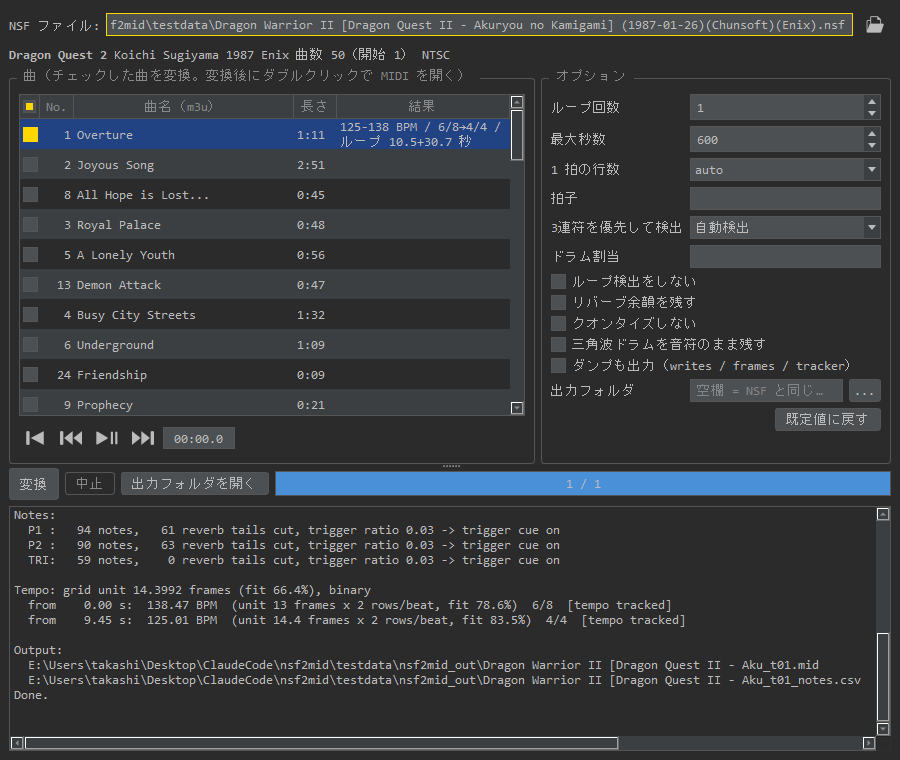

<div style="page-break-after: always; text-align: center; padding-top: 55mm;">
<p style="font-size: 26pt; font-weight: bold; color: #1a1a2e; margin: 0 0 6px;">nsf2mid</p>
<p style="font-size: 14pt; color: #555; margin: 0 0 24px;">NSF → MIDI コンバーター / NSF to MIDI Converter</p>
<p style="font-size: 13pt; color: #333; margin: 0 0 16px;">ユーザーマニュアル / User Manual</p>
<p style="font-size: 11pt; color: #888; margin: 0 0 50px;">v0.1.18</p>
<hr style="width: 50%; border: none; border-top: 1px solid #ccc; margin: 0 auto 24px;">
<p style="font-size: 9.5pt; color: #666; margin: 0 0 6px;">日本語マニュアルは次のページから始まります。</p>
<p style="font-size: 9.5pt; color: #666; margin: 0;">English manual starts on the second half of this document.</p>
</div>

# nsf2mid ユーザーマニュアル

(対象バージョン: v0.1.18)

---

## 1. 特徴

nsf2mid は、ファミコンの音楽ファイル **NSF** を **MIDI ファイル**に変換するツールです。
耳コピ用メディアプレイヤー「もろこしタイム」の派生アプリで、楽譜ソフトや DAW に読み込んで使える MIDI を作ることを目的にしています。

* **テンポ検出付き**: 発音タイミングからテンポ・拍子を検出し、拍に合わせた（クオンタイズ済みの）MIDI を出力します。
  曲の途中でテンポや拍子が変わる曲、3 連ノリ・シャッフルの曲にも対応します。
* **自然なノート判定**: 音色（duty 比）の変化、音量の揺れ（エンベロープ・トレモロ）、ビブラートは 1 つの音の中の変化として扱い、
  余計な「弾き直し」を作りません。残響のように小さな音量で鳴らし続ける「リバーブ余韻」もノートの長さから除きます。
* **ドラム変換**: ノイズ・DPCM（サンプル）・三角波キックを、GM ドラム（キック・スネア・ハイハットなど）に自動で割り当てます。
* **ループ検出**: 曲のループ点とループ長を検出し、「イントロ＋ループ 1 回」のように必要な長さだけを書き出します。
* **zip 対応**: NSF が入った zip（zophar.net 形式）をそのまま開けます。
* **簡易再生**: 変換前に曲を試聴して、変換したい曲を選べます。

> もろこしタイム v2.8.0 以降では、NSF 再生中に **Save → ファイルの種類「MIDI」** を選ぶと、同じ変換エンジンで MIDI を保存できます。
> 複数の曲をまとめて変換したいとき、CLI を使いたいときは nsf2mid 単体をお使いください。

<div style="page-break-before: always;"></div>

## 2. 動作環境・起動方法

### 必須環境

* **OS**: Windows 10 / 11（64bit）
* **Python**: 3（3.13 で動作確認。`python` / `pythonw` コマンドが使えること）
* 必要なライブラリ（**PyQt6 / numpy / sounddevice**）は、初回起動時に自動でインストールされます（インターネット接続が必要）。
* 簡易再生用の libgme.dll は `src/dll/` に同梱されています。

### 起動方法

1. **`nsf2mid.bat`** をダブルクリックすると、画面（GUI）が起動します。
2. NSF ファイル（または NSF 入りの zip）を **`nsf2mid.bat` にドラッグ＆ドロップ**すると、そのファイルを開いた状態で起動します。

コマンドラインから使う方法は「7. コマンドラインでの使い方」を参照してください。

### 設定の保存先

オプション・最後に開いたフォルダ・ファイル履歴・ウィンドウ位置は、
`%APPDATA%\nsf2mid\settings.json` に保存され、次回の起動時に復元されます。

<div style="page-break-before: always;"></div>

## 3. 画面の説明



| 場所 | 内容 |
| :---------------- | :-------------------------------------------------------- |
| **NSF ファイル** | 開いているファイルのパス。右端の**開くアイコン**でファイルを選択（右クリックでファイル履歴） |
| **情報行** | タイトル・作曲者・著作権・曲数（開始曲）・地域（NTSC / PAL）。拡張音源付きの NSF は「未対応: 2A03 の音のみ変換」と表示 |
| **曲一覧** | 変換する曲にチェックを入れます。左上のチェックボックスで全チェック / 全解除。<br>m3u（曲名リスト）があれば、曲名と長さをプレイリスト順に表示します |
| **結果** | 変換結果（テンポの範囲・拍子・ループ長など）。変換済みの行をダブルクリックすると MIDI を開きます |
| **再生ボタン** | 左から「曲頭に戻る」「前の曲」「再生 / 一時停止」「次の曲」と経過時間 |
| **オプション** | 変換の設定（「5. オプション」参照）。「既定値に戻す」ですべて初期値に戻ります |
| **変換 / 中止** | チェックした曲を順に変換 / 変換を中止 |
| **出力フォルダを開く** | MIDI の出力先フォルダをエクスプローラーで開きます |
| **ログ** | 変換の詳細（ノート数・ドラムの割当・テンポ・出力ファイル）。英語で表示されます |

<div style="page-break-before: always;"></div>

## 4. 基本的な使い方

### ステップ1: NSF ファイルを開く

開くアイコンをクリックするか、ウィンドウに NSF ファイル（`.nsf` / NSF 入りの `.zip`）をドラッグ＆ドロップします。

* 同じフォルダ（zip の場合は zip の中）に **m3u ファイル**があると、曲名と長さが表示され、プレイリスト順に並びます。
  m3u に載っていない番号（効果音など）は後ろに曲名なしで並びます。
* 開いた直後は、NSF の「開始曲」だけにチェックが入っています。

### ステップ2: 試聴して曲を選ぶ

曲の行を選んで**再生ボタン**（Space キー）で試聴できます。再生中に別の行をクリックすると、その曲を頭から再生します。
変換したい曲にチェックを入れます（複数可）。

### ステップ3: 変換する

**変換**ボタン（Enter キー）を押すと、チェックした曲を順に変換します。

* 1 曲あたり数秒〜十数秒かかります（ループを確定するために、曲を数周分エミュレートするため）。
* 進行状況はプログレスバーとログに表示されます。**中止**ボタンで止められます。
* 終わると「結果」欄にテンポ・拍子・ループ長が表示されます。

### ステップ4: MIDI を使う

出力先は、既定では **NSF と同じフォルダの `nsf2mid_out`** です（オプションの「出力フォルダ」で変更できます）。
ファイル名は `元のファイル名_t曲番号.mid`（例: `Clu Clu Land (EMU)_t01.mid`。元のファイル名は先頭 40 文字まで、zip は `.zip` / `.zophar` を除いた名前）です。

* 結果欄の行をダブルクリックすると、MIDI を既定のアプリ（楽譜ソフト・DAW など）で開きます。
* 同時に、抽出したノートの一覧 `*_notes.csv` も出力されます（確認・調査用）。

### うまく変換できないとき

| 症状 | 対処 |
| :-------------------------- | :-------------------------------------------- |
| テンポが倍・半分になる | 「1 拍の行数」を変える（例: auto → 4 や 2） |
| 3 連の曲が 2 分割になる / その逆 | 「3連符を優先して検出」を「常にオン」/「常にオフ」に |
| 拍子が違う | 「拍子」に区間ごとの拍子を指定（例 `6/8,4/4`） |
| ドラムの種類が違う | 「ドラム割当」で個別に上書き（「5. オプション」参照） |
| 音符が細切れ / 長さが不自然 | 「クオンタイズしない」「リバーブ余韻を残す」を試す |
| ループしない曲が途中で切れる / ループ判定が誤る | 「ループ検出をしない」＋「最大秒数」で長さを指定 |

<div style="page-break-before: always;"></div>

## 5. オプション

各項目にマウスを乗せると、対応するコマンドラインのオプションが表示されます。

| 項目 | 既定値 | 内容 |
| :---------------------- | :------- | :--------------------------------------------- |
| **ループ回数** | 1 | ループ部分を何回書き出すか。1 なら「イントロ＋ループ 1 回」 |
| **最大秒数** | 600 | エミュレートする最大の長さ（秒）。ループが確定するか曲が終わると、その時点で自動的に止まります |
| **1 拍の行数** | auto | 1 拍を何個の細かい単位（行）に分けるか。auto = 自動検出。<br>テンポが倍・半分に検出されたときに指定します |
| **拍子** | （空欄） | 区間ごとの拍子をカンマ区切りで指定。例 `6/8,4/4`。`-` または空欄 = 自動 |
| **3連符を優先して検出** | 自動検出 | 3 連ノリの曲を「1 拍 = 3 音」で出力するか。自動検出 / 常にオン / 常にオフ |
| **ドラム割当** | （空欄） | ドラムの割当を上書き（下記） |
| **ループ検出をしない** | オフ | ループを探さず、最大秒数の長さをそのまま変換 |
| **リバーブ余韻を残す** | オフ | 小さな音量で鳴らし続ける余韻も、音の長さに含めます |
| **クオンタイズしない** | オフ | 音符を拍のグリッドに合わせません（テンポは検出します） |
| **三角波ドラムを音符のまま残す** | オフ | 三角波の「キック」（急に音程が下がる短い音）をドラムに変換せず、三角波の音符のまま残します |
| **ダンプも出力** | オフ | 解析用のダンプ（レジスタ書き込み・フレーム状態・トラッカー表示）も出力します |
| **出力フォルダ** | （空欄） | 出力先。空欄 = NSF と同じフォルダの `nsf2mid_out` |

### ドラム割当の書き方

ログの「Drums」欄に、ドラムの種類ごとの割当が表示されます。

```
Drums (source, kind, hits -> GM note):
  NOI (3, 0)                   64 ->  42 Closed Hi-Hat  (idx 3 mode 0 ...)
  DMC ('DMC', 57344, 129, 15)  25 ->  36 Bass Drum      ($E000 len 129 rate 15 ...)
```

違う音を割り当てたいときは、`種類=GMノート番号` をカンマ区切りで指定します（よく使う番号: 36 キック / 38 スネア / 42 クローズドハイハット / 46 オープンハイハット / 49 クラッシュ / 45 ロータム）。

* ノイズ: `周期番号:モード=番号`（例 `3:0=42`）
* DPCM: `DMC:アドレス(16進):長さ:レート=番号`（例 `DMC:E000:129:15=38`。16 進のアドレスは行末の `$E000` を使います）

<div style="page-break-before: always;"></div>

## 6. 出力される MIDI

| トラック | 内容 | MIDI ch |
| :-------------- | :------------------------------------------------ | :------- |
| Track 0 | 曲名・テンポマップ・拍子・ループマーカー（`loopStart` / `loopEnd`） | — |
| Ch1 Pulse | 矩形波 1 | 1 |
| Ch2 Pulse | 矩形波 2 | 2 |
| Ch3 Wave | 三角波 | 3 |
| Ch4 Noise drums | ノイズのドラム | 10 |
| Ch5 DPCM drums | DPCM（サンプル）のドラム | 10 |
| Ch3 Wave drums | 三角波のドラム（キック） | 10 |

* ドラムトラックは、その種類のドラムがある場合のみ出力されます。
* 音色（プログラムチェンジ）は出力しません。楽譜ソフトが音色番号から楽器を推測し、移調楽器として表示したり、
  トラックを並べ替えたりするのを防ぐためです。
* 三角波は APU の実際の音高で出力します。
* ループ曲では、ループ開始位置に CC111（RPG ツクール形式のループマーカー）も入ります。
* 強弱は NSF の音量からベロシティに変換します。

<div style="page-break-before: always;"></div>

## 7. コマンドラインでの使い方

```
python src/nsf2mid.py FILE.nsf|FILE.zip [-t TRACK] [-s SECONDS] [-o OUTDIR] [オプション]
```

引数なしで実行すると GUI が起動します。

| オプション | 内容（GUI の項目） |
| :------------------------ | :---------------------------------------------- |
| `-t N` | 曲番号（1 始まり。既定は開始曲） |
| `-s N` | 最大秒数 |
| `-o DIR` | 出力フォルダ |
| `--mid-out FILE.mid` | 指定したパスに .mid だけを出力（notes.csv・ダンプは出さない） |
| `--loops N` | ループ回数 |
| `--rows-per-beat N` | 1 拍の行数 |
| `--time-sig "6/8,4/4"` | 拍子 |
| `--triplets auto/on/off` | 3連符を優先して検出 |
| `--drum-map MAP` | ドラム割当 |
| `--no-loop` | ループ検出をしない |
| `--keep-tail` | リバーブ余韻を残す |
| `--no-quantize` | クオンタイズしない |
| `--no-tri-drums` | 三角波ドラムを音符のまま残す |
| `--dump` | ダンプも出力 |
| `--info` | NSF の情報だけを表示 |
| `--unit N` | グリッドの単位（フレーム数）を直接指定（上級者向け） |
| `--tri-octave N` / `--programs` | 三角波のオクターブ移動 / 音色番号の指定（CLI のみ） |

例: 3 曲目を、ループ 2 回・6/8 拍子で変換

```
python src/nsf2mid.py "Dragon Warrior II.nsf" -t 3 --loops 2 --time-sig 6/8
```

<div style="page-break-before: always;"></div>

## 8. ショートカット

入力欄などにカーソルがあるときは、その欄の入力が優先されます。

| キー | 機能 |
| :---------- | :---------------------------------------- |
| **O** | ファイルを開く |
| **Space** | 再生 / 一時停止 |
| **←** / **→** | 前の曲 / 次の曲 |
| **Esc** | 曲頭に戻る |
| **Enter** | 変換 |

---

## 9. 制限事項

* **拡張音源**（VRC6・N163・FDS など）には対応していません。2A03 本体の音（矩形波 2・三角波・ノイズ・DPCM）だけを変換します。
* **NSFe 形式**には対応していません（NSF のみ）。
* テンポが倍・半分に検出されることがあります（例: 100 BPM と 200 BPM）。「1 拍の行数」で補正してください。
* 小節の頭（ダウンビート）は検出していません。曲の最初の音を 1 拍目とみなします。
* ビブラートやスライドなどのピッチベンドは出力しません。
* 3 連と 2 分割が頻繁に切り替わる曲では、テンポが細切れになることがあります。
* ドラムの分類は経験則によるものです。曲によっては「ドラム割当」で調整が必要です。
* 簡易再生では、ループ曲は止まらずに鳴り続けます（必要に応じて一時停止してください）。

---

## 10. あとがき

既存の変換ツールで MIDI にすると、テンポが合っていなかったり、音色の変化で音が細切れになったりして、
楽譜にするには手直しが大変でした。nsf2mid は「そのまま楽譜ソフトに読み込める MIDI」を目標に作っています。
変換がうまくいかない曲があれば、ログと一緒に教えてください。

---

**nsf2mid v0.1.18**
*Created by Ike-san*

## 更新履歴 {style="page-break-before: always;"}

| バージョン | 日付 | 内容 |
| :------- | :--------- | :---------------------------------------------------------- |
| **v0.1.11** | 2026/10/04 | 初版。NSF のエミュレーション、ノート抽出、テンポ・拍子検出、MIDI 出力、<br>ノイズ・DPCM・三角波ドラム、ループ・曲終端検出、シャッフル・リタルダンド対応 |
| **v0.1.12** | 2026/10/05 | GUI を追加（引数なしで起動） |
| **v0.1.13** | 2026/10/08 | GUI の見た目をもろこしタイムに合わせる。簡易再生を追加 |
| **v0.1.17** | 2026/10/18 | NSF 入りの zip を直接読み込み。3 連ノリの検出（3連符を優先して検出）。<br>前後の曲ボタン、開くアイコンとファイル履歴、全チェック、ショートカットを追加 |
| **v0.1.18** | 2026/11/01 | `--mid-out`（指定パスに .mid のみ出力）を追加（もろこしタイムの MIDI 保存用）。マニュアル初版 |

<div style="page-break-before: always;"></div>

<!-- EN_START -->
# nsf2mid User Manual

(Target version: v0.1.18)

---

## 1. Features

nsf2mid converts Famicom / NES music files (**NSF**) into **MIDI files**.
It is a spin-off of the music transcription player "Morokoshi Time", and aims to produce MIDI that can be loaded straight into notation software or a DAW.

* **Tempo detection**: Detects the tempo and time signature from the note timing and writes quantized MIDI aligned to the beat.
  Tempo / meter changes, triplet feel and shuffle are supported.
* **Natural note detection**: Changes of the duty cycle (timbre), volume (envelope / tremolo) and vibrato are treated as changes inside one note,
  so notes are not split into extra re-triggers. Quiet "reverb tails" that some drivers keep playing are cut from the note length.
* **Drums**: Noise, DPCM (samples) and triangle kicks are mapped to GM drums (kick, snare, hi-hat, ...) automatically.
* **Loop detection**: Detects the loop point and loop length, and writes only what is needed (e.g. "intro + 1 loop").
* **Zip support**: Zips containing an NSF (zophar.net style) can be opened directly.
* **Preview playback**: Listen to the songs before choosing which ones to convert.

> In Morokoshi Time v2.8.0 or later, choose **Save → file type "MIDI"** while playing an NSF to save MIDI with the same conversion engine.
> Use nsf2mid itself to convert many songs at once or from the command line.

<div style="page-break-before: always;"></div>

## 2. System Requirements & Launching

### System Requirements

* **OS**: Windows 10 / 11 (64-bit)
* **Python**: 3 (tested with 3.13; the `python` / `pythonw` commands must be available)
* The required libraries (**PyQt6 / numpy / sounddevice**) are installed automatically on the first launch (Internet connection required).
* libgme.dll for preview playback is included in `src/dll/`.

### Launching

1. Double-click **`nsf2mid.bat`** to start the GUI.
2. **Drag and drop** an NSF file (or a zip containing one) **onto `nsf2mid.bat`** to start with that file opened.

For command-line use, see "7. Command-Line Usage".

### Where settings are stored

Options, the last folder, the file history and the window position are saved in
`%APPDATA%\nsf2mid\settings.json` and restored on the next launch.

<div style="page-break-before: always;"></div>

## 3. Screen Overview

The GUI labels are in Japanese. The English names are given below.


| Area | Description |
| :---------------- | :-------------------------------------------------------- |
| **NSF ファイル** (NSF file) | Path of the opened file. Select a file with the **open icon** at the right end (right-click: file history) |
| **Info line** | Title, composer, copyright, number of songs (start song), region (NTSC / PAL). NSFs with expansion audio show "not supported: only 2A03 sound is converted" |
| **Song list** | Check the songs to convert. The box at the top left checks / unchecks all.<br>If an m3u (song list) exists, titles and lengths are shown in playlist order |
| **結果** (Result) | Conversion result (tempo range, meter, loop length, ...). Double-click a converted row to open the MIDI |
| **Playback buttons** | From the left: back to start, previous song, play / pause, next song, and elapsed time |
| **オプション** (Options) | Conversion settings (see "5. Options"). "既定値に戻す" (Defaults) resets them all |
| **変換 / 中止** (Convert / Stop) | Convert the checked songs one by one / stop converting |
| **出力フォルダを開く** (Open output folder) | Opens the MIDI output folder in Explorer |
| **Log** | Conversion details (note counts, drum mapping, tempo, output files) |

<div style="page-break-before: always;"></div>

## 4. Basic Usage

### Step 1: Open an NSF file

Click the open icon, or drag and drop an NSF file (`.nsf` / a `.zip` containing one) onto the window.

* If an **m3u file** is in the same folder (inside the zip for zips), titles and lengths are shown in playlist order.
  Numbers not in the m3u (sound effects, etc.) follow without titles.
* Right after opening, only the NSF's "start song" is checked.

### Step 2: Preview and choose songs

Select a row and press the **play button** (Space) to listen. Clicking another row during playback plays that song from the start.
Check the songs you want to convert (multiple songs allowed).

### Step 3: Convert

Press **変換** (Convert, Enter key) to convert the checked songs one by one.

* Each song takes a few to about ten seconds (the song is emulated for several loops to confirm the loop).
* Progress is shown in the progress bar and the log. Press **中止** (Stop) to stop.
* When finished, the result column shows the tempo, meter and loop length.

### Step 4: Use the MIDI

By default, files are written to **`nsf2mid_out` in the NSF's folder** (change it with the "Output folder" option).
The file name is `original name_tSongNumber.mid` (e.g. `Clu Clu Land (EMU)_t01.mid`; the original name is cut to 40 characters, and `.zip` / `.zophar` are removed for zips).

* Double-click a row in the result column to open the MIDI in the default app (notation software, DAW, ...).
* A list of the extracted notes, `*_notes.csv`, is also written (for checking / analysis).

### If the result is not right

| Symptom | What to do |
| :-------------------------- | :-------------------------------------------- |
| Tempo is doubled / halved | Change "Rows per beat" (e.g. auto → 4 or 2) |
| A triplet song comes out in straight time / or the opposite | Set "Prefer triplets" to "Always on" / "Always off" |
| Wrong time signature | Enter the meter per section in "Time signature" (e.g. `6/8,4/4`) |
| Wrong drum sounds | Override them with "Drum map" (see "5. Options") |
| Notes are chopped / lengths look odd | Try "No quantize" and "Keep reverb tails" |
| A non-looping song is cut / the loop is wrong | Use "No loop detection" and set the length with "Max seconds" |

<div style="page-break-before: always;"></div>

## 5. Options

Hover over an item to see the matching command-line option.

| Item | Default | Description |
| :---------------------- | :------- | :--------------------------------------------- |
| **ループ回数** (Loops) | 1 | How many times to write the loop body. 1 = intro + 1 loop |
| **最大秒数** (Max seconds) | 600 | Maximum length to emulate (seconds). Stops automatically when the loop is confirmed or the song ends |
| **1 拍の行数** (Rows per beat) | auto | How many rows (grid steps) one beat is divided into. auto = detect.<br>Set it when the tempo is detected doubled or halved |
| **拍子** (Time signature) | (empty) | Meter per section, comma-separated. e.g. `6/8,4/4`. `-` or empty = auto |
| **3連符を優先して検出** (Prefer triplets) | Auto | Whether triplet-feel songs are written as 3 notes per beat. Auto / Always on / Always off |
| **ドラム割当** (Drum map) | (empty) | Override the drum mapping (see below) |
| **ループ検出をしない** (No loop detection) | Off | Do not look for a loop; convert the full "Max seconds" |
| **リバーブ余韻を残す** (Keep reverb tails) | Off | Include the quiet tails in the note length |
| **クオンタイズしない** (No quantize) | Off | Do not snap notes to the beat grid (the tempo is still detected) |
| **三角波ドラムを音符のまま残す** (Keep triangle drums as notes) | Off | Keep triangle "kicks" (short notes with a sharp pitch drop) as triangle notes instead of drums |
| **ダンプも出力** (Also write dumps) | Off | Also write analysis dumps (register writes, frame states, tracker view) |
| **出力フォルダ** (Output folder) | (empty) | Output folder. Empty = `nsf2mid_out` in the NSF's folder |

### Drum map format

The "Drums" part of the log shows the mapping of each drum kind.

```
Drums (source, kind, hits -> GM note):
  NOI (3, 0)                   64 ->  42 Closed Hi-Hat  (idx 3 mode 0 ...)
  DMC ('DMC', 57344, 129, 15)  25 ->  36 Bass Drum      ($E000 len 129 rate 15 ...)
```

To assign a different sound, give `kind=GM note number`, separated by commas (common numbers: 36 kick / 38 snare / 42 closed hi-hat / 46 open hi-hat / 49 crash / 45 low tom).

* Noise: `period:mode=number` (e.g. `3:0=42`)
* DPCM: `DMC:address(hex):length:rate=number` (e.g. `DMC:E000:129:15=38`; use the hex address `$E000` shown at the end of the line)

<div style="page-break-before: always;"></div>

## 6. Output MIDI

| Track | Contents | MIDI ch |
| :-------------- | :------------------------------------------------ | :------- |
| Track 0 | Title, tempo map, time signatures, loop markers (`loopStart` / `loopEnd`) | — |
| Ch1 Pulse | Pulse 1 | 1 |
| Ch2 Pulse | Pulse 2 | 2 |
| Ch3 Wave | Triangle | 3 |
| Ch4 Noise drums | Noise drums | 10 |
| Ch5 DPCM drums | DPCM (sample) drums | 10 |
| Ch3 Wave drums | Triangle drums (kicks) | 10 |

* Drum tracks are written only when that kind of drum is used.
* No program changes (instruments) are written, so notation software does not guess instruments from them,
  show transposing instruments, or reorder tracks.
* The triangle is written at the APU's actual pitch.
* For looping songs, CC111 (RPG Maker style loop marker) is also placed at the loop start.
* NSF volume is converted to note velocity.

<div style="page-break-before: always;"></div>

## 7. Command-Line Usage

```
python src/nsf2mid.py FILE.nsf|FILE.zip [-t TRACK] [-s SECONDS] [-o OUTDIR] [options]
```

Running without arguments starts the GUI.

| Option | Description (GUI item) |
| :------------------------ | :---------------------------------------------- |
| `-t N` | Song number (1-based; default: start song) |
| `-s N` | Max seconds |
| `-o DIR` | Output folder |
| `--mid-out FILE.mid` | Write only the .mid to the given path (no notes.csv / dumps) |
| `--loops N` | Loops |
| `--rows-per-beat N` | Rows per beat |
| `--time-sig "6/8,4/4"` | Time signature |
| `--triplets auto/on/off` | Prefer triplets |
| `--drum-map MAP` | Drum map |
| `--no-loop` | No loop detection |
| `--keep-tail` | Keep reverb tails |
| `--no-quantize` | No quantize |
| `--no-tri-drums` | Keep triangle drums as notes |
| `--dump` | Also write dumps |
| `--info` | Show the NSF information only |
| `--unit N` | Set the grid unit (frames) directly (advanced) |
| `--tri-octave N` / `--programs` | Triangle octave shift / program numbers (CLI only) |

Example: convert song 3 with 2 loops in 6/8

```
python src/nsf2mid.py "Dragon Warrior II.nsf" -t 3 --loops 2 --time-sig 6/8
```

<div style="page-break-before: always;"></div>

## 8. Shortcuts

When an input field has the focus, typing into that field takes priority.

| Key | Function |
| :---------- | :---------------------------------------- |
| **O** | Open a file |
| **Space** | Play / Pause |
| **←** / **→** | Previous song / Next song |
| **Esc** | Back to the start of the song |
| **Enter** | Convert |

---

## 9. Limitations

* **Expansion audio** (VRC6, N163, FDS, ...) is not supported. Only the 2A03 sound (2 pulses, triangle, noise, DPCM) is converted.
* **NSFe** files are not supported (NSF only).
* The tempo may be detected doubled or halved (e.g. 100 vs 200 BPM). Correct it with "Rows per beat".
* Downbeats are not detected; the first note of the song is treated as beat 1.
* Pitch bends (vibrato, slides) are not written.
* Songs that switch often between triplets and straight time may get a fragmented tempo map.
* Drum classification is heuristic. Some songs need adjustment with "Drum map".
* In preview playback, looping songs keep playing (pause when needed).

---

## 10. Afterword

MIDI from existing converters often had the wrong tempo or notes chopped by timbre changes, so it took a lot of fixing before it could become a score.
nsf2mid aims for "MIDI you can load straight into notation software".
If a song does not convert well, please let me know together with the log.

---

**nsf2mid v0.1.18**
*Created by Ike-san*

## Update History {style="page-break-before: always;"}

| Version | Date | Changes |
| :------- | :--------- | :---------------------------------------------------------- |
| **v0.1.11** | 2026/10/04 | First version: NSF emulation, note extraction, tempo / meter detection, MIDI output,<br>noise / DPCM / triangle drums, loop / song-end detection, shuffle and ritardando support |
| **v0.1.12** | 2026/10/05 | Added the GUI (starts when run without arguments) |
| **v0.1.13** | 2026/10/08 | GUI look matched to Morokoshi Time. Added preview playback |
| **v0.1.17** | 2026/10/18 | Open zips containing an NSF directly. Triplet-feel detection (Prefer triplets).<br>Added previous / next song buttons, open icon with file history, check-all box and shortcuts |
| **v0.1.18** | 2026/11/01 | Added `--mid-out` (write only the .mid to a given path; for Morokoshi Time's MIDI save). First manual |
